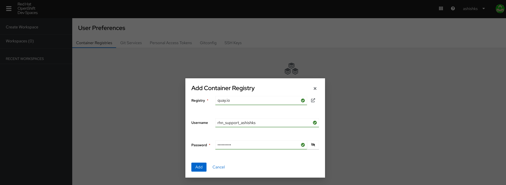
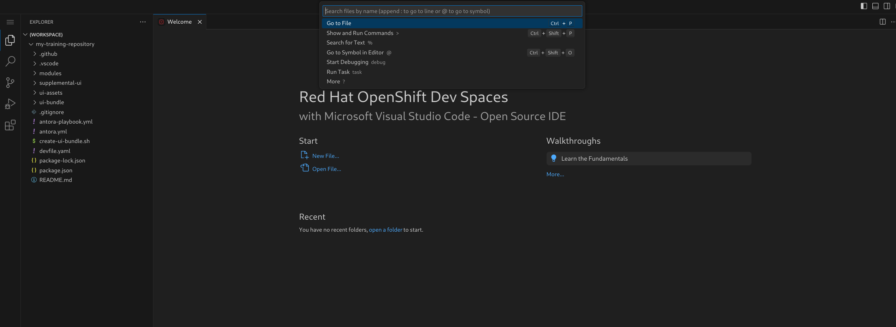
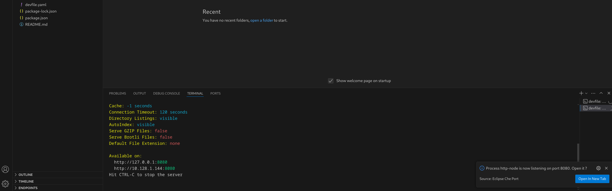

## Development using OpenShift Dev Spaces

Use Dev Spaces when you prefer a browser IDE instead of a local Antora build.

### 1. Open Dev Spaces for your course repo

After you create your repository from the template and run `course-init.sh`, open:

**https://devspaces.apps.tools-na100.dev.ole.redhat.com/#https://github.com/RedHatQuickCourses/YOUR-REPO-NAME**

Replace `YOUR-REPO-NAME` with your repository name (the same value that replaced `REPLACEREPONAME`).

You can also use the Contribute badge in `README-TRAINING.md` after init (it becomes the top of `README.md`).

### 2. Log in

1. Click **Log in with OpenShift**.
2. Choose **my_htpasswd_provider**.
3. Sign in with your username and password.
4. On **Authorize Access**, ensure **user:full** is selected, then allow.

### 3. Configure quay.io credentials (container registry)

1. Open **User Preferences** (username menu, top right).
2. Under **Container Registries**, click **Add Container Registry**.
3. Registry: `quay.io` — Username: your quay.io login — Password: your quay.io password — then **Add**.

### 4. Create a workspace from Git

1. Click **Create Workspace**.
2. Under **Import from Git**, paste your training repository URL.
3. Click **Create & Open**.

NOTE: Initialize the repository (`course-init.sh`) and push those commits before opening Dev Spaces.

### 5. Install, watch, and serve

1. Use the workspace search bar → **Run Task** → **devfile**.
2. Run **0-install** and wait for it to finish.
3. Run **1-watch**.
4. Run **2-serve**.
5. When prompted, **Open In New Tab** (and allow VS Code to open the external site).

Rendered content appears in the new tab. Saving AsciiDoc in the Dev Spaces editor updates the preview after refresh.

**SEE ALSO**

- [Getting started with a new training content repository](./README.md)
- [Guideline for editing your content](./USAGEGUIDE.adoc)
